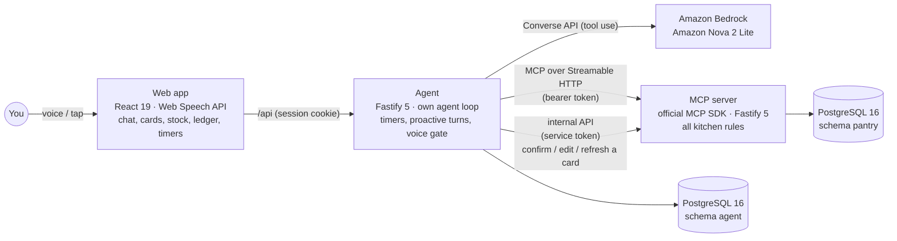

# PantryMos

**Mos, your kitchen's little helper.** PantryMos is a hands-free kitchen agent. It keeps your kitchen's stock batch by batch, plans a meal from what is about to go bad, talks you through the recipe with timers, and handles surprises while you cook. It never changes your stock until you say so.

> The kitchen itself is a standalone **MCP server**, and our own agent uses it as its tools. The agent runs on **Amazon Bedrock (Amazon Nova 2 Lite)** by default, on any OpenAI-compatible model API (OpenAI, or a local server such as Ollama), or on your ChatGPT plan through Sign in with ChatGPT. The voice front end runs in the browser (Web Speech API, English only).

- [The problem](#the-problem)
- [What PantryMos does](#what-pantrymos-does)
- [Where MCP and the models are in the code](#where-mcp-and-the-models-are-in-the-code)
- [Architecture](#architecture)
- [How it works](#how-it-works)
- [Keeping the record right](#keeping-the-record-right)
- [Quality: tests and model evaluation](#quality-tests-and-model-evaluation)
- [Limitations](#limitations)
- [Running it](#running-it)

---

## The problem

You open the fridge and find another box of spinach you forgot about, now spoiled. You can't remember when you bought the milk, or what you could cook with what you have. Then, halfway through a recipe with wet hands, you have to unlock your phone to read the next step.

What goes wrong is easy to name:

- **People forget what they have.** They buy duplicates, and older food spoils while newer food gets used first.
- **Dates are fuzzy.** Two cartons of milk bought a week apart are not the same milk. A plain "milk: 2" list can't say which to use first.
- **Cooking takes both hands.** Reading a recipe, setting timers and checking stock on a screen all get in the way.

Plenty of apps suggest recipes. One case PantryMos is built for is cooking from what's in **your own kitchen**: it remembers what you have, since when, and what's left after you cook, and you keep that record up to date by talking instead of typing.

## What PantryMos does

Tell Mos what you bought. It records each **batch** on its own: how many, when you bought it, and the date on the package if there is one. Two cartons of milk with different dates stay two batches.

At dinner time, say a goal instead of a command:

> **"Mos, make dinner for three with whatever's about to go bad."**

Mos checks what needs using first, picks a recipe you can actually make, and **says why**: "it uses the spinach you've stored for 5 days and the milk that's best by Oct 15 (from package)". Then it starts the recipe.

While you cook, you don't touch the screen:

- Say **"next"** for the next step. The app reads each step from the recipe, word for word.
- When a step takes time ("simmer for 8 minutes"), Mos offers a timer. Say "yes", and Mos speaks up on its own when the time is up.
- Spilled half the milk? Tell Mos. It works out whether you still have enough and offers a way out: fewer servings, a substitute, or adding milk to the shopping list.
- Missing an ingredient with exactly one substitute in stock? Mos uses it and tells you. With several, it asks.

When you're done, Mos reads back what you used: "I'll record 3 eggs, 2 tomatoes and 15 milliliters of olive oil. Say confirm, or tell me what to change." **Only when you say "confirm" does your stock change.** Got it wrong? "Actually I used four eggs" makes a correction card, and "undo that" reverses a change. Nothing is ever erased: every change is in a ledger you can read.

**Your kitchen record changes only in ways you confirmed.**

### Capabilities

| Area | What you can do |
|---|---|
| Groceries | Add purchases by voice. Mos asks for what it can't know ("how many eggs in a carton?", "is this counted or weighed?") and never guesses a date. |
| Stock | Ask what you have, batch by batch, and what needs using first. Each date says where it came from: `best by Oct 18 (from package)` or `stored for 5 days, no package date`. |
| Meals | Recipes ranked by what you can make and how well they use food that needs using. Amounts scaled to the servings you ask for. |
| Cooking | Step-by-step guidance, step timers (start, pause, resume, cancel), substitutes, skipping an optional ingredient. |
| Corrections | Record a discard or spill ("half the milk"), fix a stock count, revise what a meal used, undo one change or a whole meal. |
| Shopping list | Add items by voice, including what a recipe was short of. |
| Trust | A ledger of every change: what changed, whether it was confirmed by voice (and what was said) or by a tap, which version of the card, and whether it was undone. |

## Where MCP and the models are in the code

MCP is the system's spine. The model behind the agent is one of three, Amazon Bedrock by default:

| Technology | Where it is used |
|---|---|
| **MCP server** (official `@modelcontextprotocol/sdk` 1.32.1, Streamable HTTP, protocol 2025-11-25) | [`apps/mcp-server/src/mcp/server.ts`](apps/mcp-server/src/mcp/server.ts) builds an `McpServer` and registers all 16 kitchen tools; each tool calls `server.registerTool` in [`apps/mcp-server/src/mcp/tools/`](apps/mcp-server/src/mcp/tools/). [`apps/mcp-server/src/app.ts`](apps/mcp-server/src/app.ts) serves it at `POST /mcp` with `StreamableHTTPServerTransport`, behind a bearer token. Entry point: [`apps/mcp-server/src/index.ts`](apps/mcp-server/src/index.ts). |
| **MCP client** | [`apps/agent/src/mcpClient.ts`](apps/agent/src/mcpClient.ts) connects with `Client` and `StreamableHTTPClientTransport`. [`apps/agent/src/tools/mcp.ts`](apps/agent/src/tools/mcp.ts) turns `tools/list` into the model's tool list and runs `tools/call`. |
| **Amazon Bedrock Converse API**, Amazon Nova 2 Lite (default) | [`apps/agent/src/model/bedrock.ts`](apps/agent/src/model/bedrock.ts) sends `ConverseCommand` with `toolConfig` through `BedrockRuntimeClient` (`@aws-sdk/client-bedrock-runtime`); model `global.amazon.nova-2-lite-v1:0`, temperature 0. The agent loop that uses it: [`apps/agent/src/turn/runTurn.ts`](apps/agent/src/turn/runTurn.ts). Entry point: [`apps/agent/src/index.ts`](apps/agent/src/index.ts). |
| **Any OpenAI-compatible Chat Completions API** (`MODEL_PROVIDER=openai`) | [`apps/agent/src/model/openai.ts`](apps/agent/src/model/openai.ts) maps the same turn loop to `POST /chat/completions` with `tools`, using `fetch`. [`apps/agent/src/model/create.ts`](apps/agent/src/model/create.ts) picks the provider. |
| **A ChatGPT plan, through Sign in with ChatGPT** (`MODEL_PROVIDER=chatgpt`) | [`apps/agent/src/model/responses.ts`](apps/agent/src/model/responses.ts) runs the turn loop on the Responses API (`POST /v1/responses`, streamed, `store: false`). [`apps/agent/src/chatgpt/`](apps/agent/src/chatgpt/) signs in with OAuth (PKCE, a `127.0.0.1` callback), keeps the token fresh and signs out; [`apps/web/src/ui/Plan.tsx`](apps/web/src/ui/Plan.tsx) is the "Continue with ChatGPT" button. |

You can also call the MCP server directly with MCP Inspector; see [Trying the MCP server](#trying-the-mcp-server-with-mcp-inspector).

## Architecture



Three services, one rule: **the model proposes, you confirm, the server commits.**

- **Web app** (`apps/web`): a single-page React app. Push-to-talk, a hands-free mode that listens for "Mos, …", spoken replies, and cards you can confirm, edit, discard or refresh. It polls the agent every 2 seconds for new messages, stock, the ledger and timers.
- **Agent** (`apps/agent`): owns the conversation, not the kitchen. It runs the model ↔ tool loop on Bedrock, keeps timers, sends proactive messages, and decides voice confirmations in code (the *ConfirmGate*).
- **MCP server** (`apps/mcp-server`): owns the kitchen. Every rule about stock, dates, recipes and cooking sessions is deterministic code here. Its MCP tools can read and **propose**, never commit. Commits arrive only through a separate internal API, which the model has no tool for.
- **PostgreSQL**: each service has its own schema and its own database role, with no access to the other's. The ledger tables are append-only at the privilege level (`REVOKE UPDATE`).

### Stack

| Layer | Technology |
|---|---|
| Front end | TypeScript, React 19, Vite 8, Web Speech API (`SpeechRecognition`, `SpeechSynthesis`) |
| Back end | TypeScript on Node.js 24 (no build step), Fastify 5, Zod 4, `pg` (plain SQL, no ORM) |
| AI | Amazon Bedrock Converse API, Amazon Nova 2 Lite, `@aws-sdk/client-bedrock-runtime`; or any OpenAI-compatible Chat Completions API; or the Responses API on a ChatGPT plan |
| Tools protocol | MCP, official TypeScript SDK, stateless Streamable HTTP |
| Data | PostgreSQL 16: relational tables plus JSONB for card plans and conversation content |
| Auth | Browser → agent: HMAC-signed session cookie, optional passcode. Agent → MCP: bearer token (stored as a SHA-256 hash, mapped to a household). Agent → internal API: service token |
| Deployment | Docker multi-stage image; Docker Compose for Postgres, migrations, MCP server and agent |
| Tests | Vitest, fast-check, jsdom + Testing Library; a separate eval against real Bedrock |

## How it works

### One request, end to end

"I bought six eggs":

1. The web app sends the text to `POST /api/chat` with a conversation id and a request id.
2. The agent takes a lease on the conversation, so two requests can't interleave in it.
3. The agent sends the conversation, the system prompt and the tool list (from MCP `tools/list`, plus its own timer tools) to the model: by default Nova 2 Lite, through the Bedrock Converse API.
4. The model asks for `propose_intake`. The agent calls it over MCP.
5. The MCP server works out the item, amount, unit and dates in code, and saves a **versioned proposal**. Stock is unchanged.
6. The agent returns Mos's reply with the card. The web app shows the card and reads it aloud, ending with one question: "Say confirm, or tell me what to change."
7. You tap **Confirm**, or say "confirm" while the card's voice window is open.
8. The agent calls the internal API: `POST /internal/proposals/:id/confirm`, for exactly the version you saw or heard.
9. In one transaction, the MCP server locks the proposal and the batches it touches, checks they haven't changed, and writes the operation, the new batch and its ledger event ([`commit/confirm.ts`](apps/mcp-server/src/commit/confirm.ts)).
10. Only after the commit event comes back may Mos say "saved".

### Why the kitchen sits behind MCP

The MCP server is not a thin wrapper over the database; it is the kitchen's domain and safety boundary. The model sees these tools:

| Read | Cook | Propose (makes a card, changes nothing) | Direct |
|---|---|---|---|
| `list_inventory`, `expiring_soon`, `suggest_recipes`, `get_session`, `list_recent_operations` | `start_cooking`, `next_step`, `substitute`, `skip_ingredient`, `cancel_cooking` | `propose_intake`, `propose_consumption`, `propose_consumption_revision`, `propose_adjustment`, `propose_undo` | `add_to_shopping_list` (doesn't touch stock) |

Plus five agent-local timer tools (`start_timer`, `pause_timer`, `resume_timer`, `cancel_timer`, `list_timers`): timers are part of the cooking experience, not kitchen data.

**There is no tool to confirm or commit.** A prompt injection, a misheard word or a confused model can at most make a card that you then decline.

### The data model

- **Batches, not totals.** Each purchase is its own batch: quantity, purchase date, opened date, package date and its kind (use-by, best-by or none), a *priority date*, a version and a status.
- **Priority date.** The package date if there is one; otherwise the purchase date plus the item's usual keeping days, or 7 days if unknown ([`domain/priority.ts`](apps/mcp-server/src/domain/priority.ts)). An estimate is always labelled as one; Mos never calls it an expiry date.
- **FEFO.** Using up stock takes from the batch that should go first: first expired, first out ([`domain/allocation.ts`](apps/mcp-server/src/domain/allocation.ts)).
- **A ledger, not a counter.** Every change is an *operation* with one *inventory event* per batch touched. Corrections and undos add new events in the other direction; nothing is overwritten. That makes every change auditable, correctable and reversible.
- **Versioned proposals.** A card stores the plan it will carry out, the batch versions and cooking state it depends on, and the text that was read to you. Editing a card makes a new version. If the kitchen changed since the card was made, confirming it fails as **stale** and you're asked to refresh it; it is never quietly recomputed and applied.

### Recommending a meal

`suggest_recipes` scales each recipe to your servings, checks stock and substitutes, works out which batches the meal would use, and ranks recipes: makeable first, then those using more food that needs using, then the earliest dates. The reason Mos gives quotes the server's date labels, so it says "stored for 5 days" when that's all it knows.

### Cooking, timers and proactive messages

- `start_cooking` opens a cooking session with its planned usage; `next_step` moves exactly one step, and only from the step you last heard. The agent counts the "next"s you said and refuses any extra `next_step` the model tries.
- A step with a time gets a timer offer from the app. Say yes and the agent starts it.
- When a timer fires, the agent records an event. A background worker claims it and runs a **proactive turn** with a restricted tool set: it can't propose changes or move a step, only tell you. The message is stored and spoken on the browser's next poll.

### Hands-free voice confirmation

Saying "yes" is decided by code, not by the model ([`gate/confirmGate.ts`](apps/agent/src/gate/confirmGate.ts)):

1. Mos reads the card aloud. The browser reports when it was **heard to the end**; only then does a 30-second voice window open.
2. Within that window, an exact short phrase ("yes", "confirm", "that's right", …) confirms, or "cancel" discards. This runs **before** the model sees the words.
3. The confirmation is bound to the **version that was read**. If you edited the card meanwhile, the old version can't be confirmed.
4. Anything else ("yes, but three eggs") is a normal turn for Mos, not a confirmation. Your next turn or a tap on a card closes the window.

## Keeping the record right

You keep your kitchen record by talking, and a language model turns what you say into tool calls. The prompt tells the model how to behave; the code below makes sure the record stays right even when speech is misheard or the model gets something wrong.

### Business rules live in code

Units, dates, priorities, FEFO, recipe scaling, substitutions, undo and card text are all deterministic code in the MCP server. The model understands what you said and phrases the reply; it doesn't compute stock. The agent also fills in what you decided from your own words, not from the model: the step you last heard (`expected_step`) and whether you chose a substitute (`chosen_by_user`). With several substitutes in stock, the server refuses until you've picked one.

### Duplicates, retries and races

| Problem | Defense |
|---|---|
| The same HTTP request sent twice (double tap, retry) | A request log keyed by request id returns the first result; the same id with different input is rejected |
| A crash in the middle of a tool call | A tool-call journal: finished calls aren't rerun, pending ones are retried with the same request id |
| The MCP server committed, but the agent never heard back | A second request log on the MCP server returns the saved result |
| Two messages in one conversation at once | A conversation lease |
| Two commits on the same batch | `SELECT … FOR UPDATE` in a fixed lock order |
| The kitchen changed after a card was made | Version and precondition checks: the card goes stale |
| Two requests creating the same thing (a cooking session, a confirmation) | Unique indexes |
| Two requests creating the same new catalog item | Advisory locks on the item's key |
| A commit that only half happens | One transaction |

### What Mos says is checked

Nova sometimes says things the turn doesn't back up. Before a reply is spoken or kept in history, the agent's speech guardrails ([`turn/grounding.ts`](apps/agent/src/turn/grounding.ts)):

- leave out claims that stock was saved, deducted or changed unless a commit really happened in the turn, and claims that a timer is running unless one was started;
- leave out the model's own retelling of a card or a recipe step, since the app reads those from the server word for word;
- keep one question at the end: the card's or the timer offer's, not the model's;
- turn markdown into plain speech;
- drop a reply Bedrock flags as malformed or cut off by the token cap (Nova sometimes wrote out its reasoning untagged until it hit the cap), and ask again.

### Security

- Each service has its own Postgres role and schema; the agent's role cannot read the kitchen's tables.
- The MCP and internal listeners bind to `127.0.0.1` only. In Docker, the agent shares the MCP server's network namespace and only the agent's port is published.
- Origin checks on state-changing browser requests and on MCP requests; rate limits on the API, MCP, proposals and confirmations.
- Server faults return `{"error": "internal_error"}` only, never the database's message.
- A ChatGPT plan's tokens are stored encrypted (AES-256-GCM, each bound to its column) under `CHATGPT_TOKEN_KEY`, which stays out of the database: a copy of the database alone can't use the sign-in. Tokens the key can't open count as signed out.

## Quality: tests and model evaluation

**Deterministic tests check the code; the model eval checks the model's behaviour.**

```bash
pnpm test:coverage    # all tests, with the coverage gate
```

- **Unit tests** for pure logic: units, dates, priorities, FEFO, scaling, substitutes, revisions, undo, card text and the speech guardrails. **Property-based tests** (fast-check) for FEFO allocation, date math, recipe scaling, text handling and canonical JSON hashing.
- **Integration tests** against a real PostgreSQL, real HTTP listeners and the real MCP transport: duplicate confirms, stale cards, correction then undo, concurrent consumption, resuming a turn after a crash, the ConfirmGate and voice windows, proactive turns, security checks. The model is replaced by a scripted stand-in.
- **View tests** for the React cards, chat and panels in jsdom.
- **Performance**: a kitchen of 50 items, 200 batches and 500 events; every MCP tool answers within 200 ms at p95 (measured 26–114 ms locally).
- **CI** (GitHub Actions): type check, all tests with a coverage gate (at least 85% of lines and 80% of branches), and the Docker image build.

### Evaluating the model

`pnpm eval` runs the whole stack against a real model on multi-turn scenarios (Nova 2 Lite on Bedrock, or whichever model `MODEL_PROVIDER` picks): the full hands-free cook, goal requests, substitutes, mid-cook spills, timers, corrections, undo, stale cards, double confirms and "just deduct it" without a card. Each run is scored on four checks:

1. the right tools, 2. the right arguments, 3. the right database state afterwards, 4. a reply that matches the facts (claims extracted by a separate judge model and checked against the database).

What it was used for:

- **Choosing the model.** On the same build, Nova 2 Lite got tools, arguments and stock right in 30 of 36 runs, against 13 of 36 for Nova Pro, at about two thirds of the cost.
- **Finding what to fix.** Reading the transcripts led to the speech guardrails above. Where the judge itself was wrong, the case was reviewed by hand and the judge's rules corrected.
- **Checking the fixes.** A problem found in a conversation becomes a scenario, such as "a dozen" eggs recorded as 144: run before the fix to show it, and after to confirm it is gone.

**On Nova 2 Lite** (two runs per case): 25 of 25 cases at commit `77430c3`.

**On a ChatGPT plan** (the plan's default model, one run per case): 25 of 25 cases at commit `3f4ffb2`. The first full run, at `e3dee9b`, passed 22: all three failures (P2a, P2b, P16) had one cause, the model naming a meal it was correcting by a short name ("stir-fry") that didn't match a recipe. `3f4ffb2` fixed it (a short name finds the one recent meal it fits), and the whole eval was run again. Each run writes a report with every conversation to `docs/eval-log.md`; the reports are not kept in this repository.

## Limitations

- **Tuned on one model.** The prompt and speech guardrails were tuned on Nova 2 Lite. A ChatGPT plan's default model also passed the full eval, one run per case (see [Evaluating the model](#evaluating-the-model)); OpenAI's gpt-4.1-mini passed a 4-case spot check; nothing else has been tried. Run `pnpm eval` on a model before relying on it (the eval's reply check still runs on Bedrock).
- **One ChatGPT sign-in per agent**, from a browser on the machine the agent runs on: OpenAI calls back only to `127.0.0.1`.
- **Voice runs in the browser.** Speech goes through the Web Speech API (English, `en-US`); there is no smart-speaker or phone app.
- **Five seeded recipes**, written by hand; PantryMos doesn't generate recipes. More can be added: add an entry to [`db/seed/recipes.ts`](db/seed/recipes.ts) (ingredients, substitutes, steps and their timers), with any new ingredient in [`db/seed/catalog.ts`](db/seed/catalog.ts), and run `pnpm db:seed` again; it adds only what's new.
- **One demo household.** No multi-household accounts.
- **Polling, not push.** The browser polls every 2 seconds, so a timer announcement can arrive up to 2 seconds late. Messages are stored first, so none are lost. Server-sent events would be the next step.
- **Timer announcements cost more than they need to.** When a timer fires, Nova sometimes calls read tools before speaking: the announcement comes 2–3 seconds later and uses about 11.5k input tokens. It still goes through the model on purpose, so Mos can mention what else is going on.
- **Not tested automatically:** the browser's speech recognition and synthesis adapters; these were checked by hand.
- **Not deployed to AWS.** The containers mirror an ECS task (shared network namespace, one published port), but there is no infrastructure code.

## Running it

### Requirements

- Node.js 24 (`.nvmrc`) and pnpm 11
- Docker (for PostgreSQL, or for the whole stack)
- A model, for talking to Mos (not needed for tests): AWS credentials with access to Amazon Nova 2 Lite on Bedrock, an OpenAI-compatible API (an OpenAI key, or a local server such as Ollama), or a ChatGPT plan

### With Docker

```bash
cp .env.example .env          # set AWS_PROFILE to a profile in ~/.aws
docker compose up --build
```

Then open <http://127.0.0.1:7400>. Compose starts Postgres, runs migrations and seeds a demo household, then starts the MCP server and the agent, which serves the web app. Your `~/.aws` is mounted read-only into the agent.

### For development

```bash
cp .env.example .env
pnpm install
pnpm db:up            # PostgreSQL on 127.0.0.1:5432
pnpm db:bootstrap     # roles and databases
pnpm db:migrate
pnpm db:seed          # demo household, catalog, recipes, agent token; prints a dev Inspector token once

pnpm dev:mcp          # MCP on 127.0.0.1:7410, internal API on 127.0.0.1:7411
pnpm dev:agent        # API on 127.0.0.1:7400
pnpm dev:web          # http://127.0.0.1:5173
```

Model settings are in `.env`. Bedrock (the default, `MODEL_PROVIDER=bedrock`): `AWS_PROFILE`, `BEDROCK_REGION` and `BEDROCK_MODEL_ID` (default `global.amazon.nova-2-lite-v1:0`). Another model: set `MODEL_PROVIDER=openai`, `OPENAI_MODEL`, and `OPENAI_BASE_URL` and `OPENAI_API_KEY` as the server needs. For example, Ollama on the same machine:

```bash
MODEL_PROVIDER=openai
OPENAI_BASE_URL=http://127.0.0.1:11434/v1
OPENAI_MODEL=qwen3:8b
```

A ChatGPT plan: set `MODEL_PROVIDER=chatgpt` and `CHATGPT_TOKEN_KEY` (at least 32 characters, for example from `openssl rand -base64 32`; the sign-in's tokens are encrypted under it, and changing it signs you out), start the agent, and choose **Continue with ChatGPT** in the app. Requests then use your plan's usage, and the app links to where you manage it. OpenAI calls back to `http://127.0.0.1:<port>/auth/chatgpt/callback` on the agent, so sign in from a browser on the same machine; the port is `AGENT_PORT` unless `CHATGPT_CALLBACK_PORT` sets it. `CHATGPT_MODEL` picks a model (unset: the plan's default). With `pnpm dev:web`, also set `CHATGPT_RETURN_URL=http://localhost:5173/` so the browser comes back to the dev server. `pnpm eval` with `MODEL_PROVIDER=chatgpt` uses the sign-in saved in the dev database, so sign in from the app first.

### Tests and eval

```bash
pnpm db:up
pnpm typecheck
pnpm test               # everything; recreates the pantrymos_test database each run
pnpm test:unit          # pure logic, no database needed
pnpm test:integration   # real Postgres and HTTP listeners
pnpm test:coverage      # all tests plus the coverage gate CI enforces

pnpm eval               # real model calls (billable); writes docs/eval-log.md
```

### Connecting another MCP client

Any MCP client that speaks Streamable HTTP can use the kitchen with its own token: a desktop assistant, a script, later a voice terminal. Issue one per client, by name; it belongs to the agent's household (`AGENT_HOUSEHOLD_ID`, the demo one by default):

```bash
pnpm mcp:client "Claude Desktop"            # prints the token once; only its hash is stored
pnpm mcp:client --revoke "Claude Desktop"
```

Point the client at `http://127.0.0.1:7410/mcp` with `Authorization: Bearer <token>`: the MCP server listens on the same machine only, and only in the development setup (`pnpm dev:mcp`), since Docker publishes just the agent's port. The client sees the same kitchen tools as Mos (timers are the app's own), and the same rule holds: a `propose_*` tool only makes a card. The card waits in the web app under **Waiting for you to confirm**, marked with the client's name, until you confirm or discard it there. Once it's confirmed, Mos says so in the chat you have open. There is one pending card per subject, so if a card for the same subject is already waiting in the chat, the client's call updates that card instead, and nothing new appears in the inbox.

The agent sends `_meta` ids with each write (`pantrymos/request_id`, `pantrymos/conversation_id`); another client may leave them out. Without a request id, a retried call isn't recognized as a retry and runs again. Some tools guard against that: a repeated `propose_*` lands on the same pending card, and `next_step` checks `expected_step`, so it can't move on twice. Others don't: a repeated `add_to_shopping_list` adds the item twice. Without a conversation id, the client's writes go to a conversation of its own.

Not yet tried with a real third-party client, only with the official SDK's client in tests and against the dev stack. Some desktop clients connect to remote servers only over HTTPS or with OAuth, which PantryMos doesn't offer.

### Trying the MCP server with MCP Inspector

The first `pnpm db:seed` prints a dev Inspector token. Only its hash is stored, so copy it then. To get a new one, revoke the `inspector-dev` row in `pantry.api_clients` and seed again.

```bash
npx @modelcontextprotocol/inspector --cli http://127.0.0.1:7410/mcp --transport http \
  --header "Authorization: Bearer $INSPECTOR_TOKEN" --method tools/list
```

Browser-based Inspector sessions also need their origin in `MCP_ALLOWED_ORIGINS`. Inspector is a client like any other: its cards show up in the web app's inbox.

### Repository layout

```
apps/
  web/           React app: chat, cards, kitchen and ledger panels, speech adapters
  agent/         Agent: model loop, ConfirmGate, speech guardrails, timers, workers
    eval/        Model evaluation against a real model
  mcp-server/    MCP server: tools, domain rules, proposals, commits, internal API
packages/shared/ Code shared by all three (confirmation phrases, hashing, tool results)
db/              SQL migrations and seed data (catalog, recipes)
scripts/         Database bootstrap, migrations, seeding, MCP client tokens
test/            Shared test fixtures and setup
```

## License

[MIT](LICENSE)
